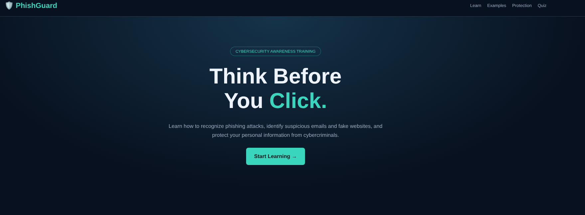
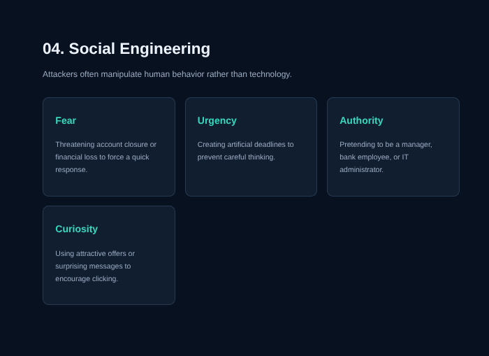

# CodeAlpha_PhishingAwarenessTraining
# 🛡️ PhishGuard — Cybersecurity Awareness Training


**PhishGuard** is an interactive, single-page web application designed to educate users on recognizing phishing attacks, identifying fake websites, understanding social engineering tactics, and adopting safe online habits.

> *Created as part of the **CodeAlpha Cyber Security Internship**.*

---

## 📋 Table of Contents

- [Overview](#-overview)
- [Features](#-features)
- [Screenshots](#-screenshots)
- [Project Structure](#-project-structure)
- [Getting Started](#-getting-started)
- [Code Architecture](#-code-architecture)
- [Future Improvements](#-future-improvements)
- [Disclaimer](#-disclaimer)

---

## 🔍 Overview

Phishing remains one of the most common entry points for cyberattacks. **PhishGuard** provides a structured, beginner-friendly training module broken down into six core sections, culminating in an interactive 5-question assessment to reinforce key concepts.

Built entirely with vanilla **HTML5, CSS3, and JavaScript**, the application requires zero external dependencies or build tools, making it lightweight, fast, and easy to deploy anywhere.

---

## ✨ Features

* **01. Understanding Phishing:** Breaks down core attack vectors including Email Phishing, Smishing (SMS), Spear Phishing, and Website Phishing.
* **02. Recognizing Phishing Emails:** Highlights red flags (suspicious senders, urgent language, unexpected links/attachments) alongside a **simulated phishing email dissection**.
* **03. Identifying Fake Websites:** Teaches users how to spot look-alike domains, fake login pages, and why HTTPS alone does not guarantee legitimacy.
* **04. Social Engineering Tactics:** Explains psychological triggers used by attackers—**Fear, Urgency, Authority, and Curiosity**.
* **05. Protection & Incident Response:** Provides actionable security best practices (MFA, password hygiene, reporting) and a step-by-step recovery checklist if a user clicks a malicious link.
* **06. Interactive Knowledge Quiz:** A 5-question multiple-choice quiz with instant answer validation, explanatory feedback, button state locking, and final percentage scoring.
* **Responsive Dark-Mode UI:** Clean, modern cybersecurity aesthetic built with CSS custom properties (`:root`), responsive CSS Grid layouts, and sticky navigation.

---

## 📸 Screenshots

| Hero & Navigation | Recognizing Phishing Emails |
| :---: | :---: |
|  |  |

| Identifying Fake Websites | Social Engineering Tactics |
| :---: | :---: |
|  |  |

| How to Stay Protected | Interactive Knowledge Quiz |
| :---: | :---: |
|  |  |

---


## 🚀 Getting Started

Because PhishGuard has no external dependencies, running it locally takes seconds:

1. **Clone the repository:**
   ```bash
   git clone [https://github.com/your-username/PhishGuard.git](https://github.com/Abdesslam-OMA/PhishGuard.git)
   ```
2. **Navigate to the project directory:**
   ```bash
   cd PhishGuard
   ```
3. **Launch the application:**
   - Double-click `index.html` to open it directly in any modern web browser, **or**
   - Serve it using a local development server (e.g., VS Code Live Server or Python):
     ```bash
     python -m http.server 8000
     ```
     Then visit `http://localhost:8000`.

---

## 🛠️ Code Architecture

* **Styling (`<style>`):** Uses CSS variables (`--bg`, `--panel`, `--accent`, `--red`) for consistent theming, `clamp()` for fluid typography, and `repeat(auto-fit, minmax(220px, 1fr))` grids for mobile responsiveness.
* **Quiz Engine (`<script>`):**
  * Stores questions, answer arrays, correct indices, and explanations in a structured `questions` array.
  * Dynamically renders DOM elements via `renderQuestion()`.
  * Prevents multiple submissions per question using an `answered` state flag and highlights the correct border color upon selection.
  * Calculates final percentage scores and supports full state resets via the **Try Again** button.

---


## ⚠️ Disclaimer

This project was created strictly for **educational and cybersecurity awareness purposes**. All email addresses, links, and phishing scenarios displayed in the application are simulated and non-functional.
