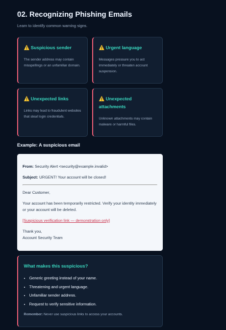
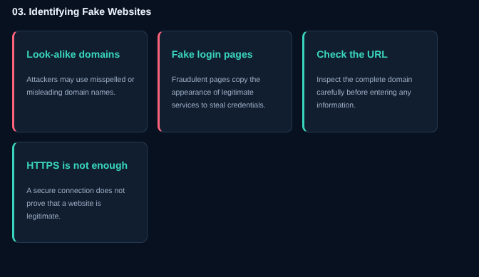
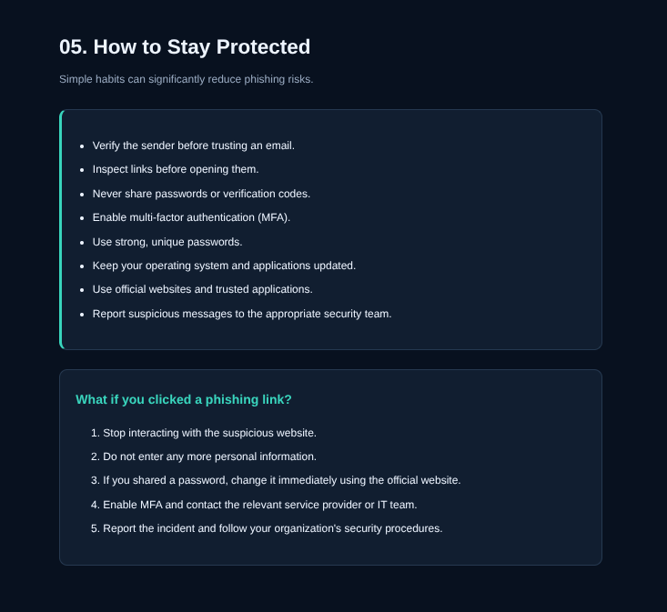
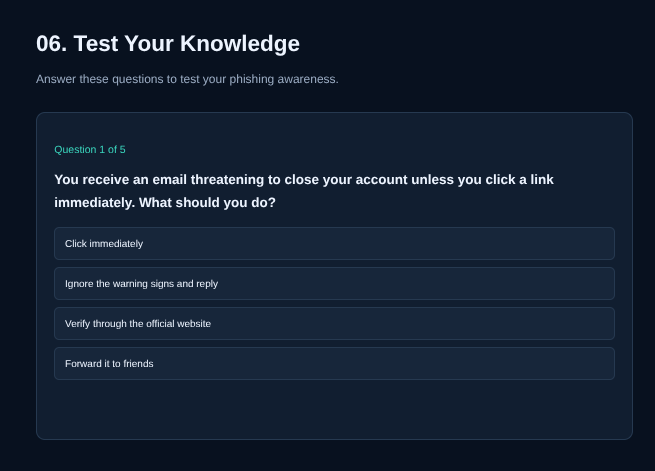

# CodeAlpha_PhishingAwarenessTraining
# 🛡️ PhishGuard — Cybersecurity Awareness Training


**PhishGuard** is an interactive, single-page web application designed to educate users on recognizing phishing attacks, identifying fake websites, understanding social engineering tactics, and adopting safe online habits.

> *Created as part of the **CodeAlpha Cyber Security Internship**.*

---

## 📋 Table of Contents

- [Overview](#-overview)
- [Features](#-features)
- [Screenshots](#-screenshots)
- [Project Structure](#-project-structure)
- [Getting Started](#-getting-started)
- [Code Architecture](#-code-architecture)
- [Future Improvements](#-future-improvements)
- [Disclaimer](#-disclaimer)

---

## 🔍 Overview

Phishing is one of the most common cybersecurity threats. Attackers use deceptive emails, fake websites, and social engineering techniques to steal sensitive information.

PhishGuard provides a beginner-friendly training experience through educational content, practical examples, and an interactive five-question quiz.

The project is built using HTML5, CSS3, and JavaScript, with no external dependencies or build tools required.

---

## ✨ Features

* **01. Understanding Phishing:** Learn about email phishing, smishing, spear phishing, and website phishing.
* **02. Recognizing Phishing Emails:** Identify suspicious senders, urgent messages, malicious links, and unexpected attachments.
* **03. Identifying Fake Websites:** Learn to recognize suspicious domains, fake login pages, and misleading HTTPS indicators.
* **04. Social Engineering Tactics:** Understand how attackers exploit fear, urgency, authority, and curiosity.
* **05. Protection & Incident Response:** Discover security best practices, including multi-factor authentication, strong passwords, and reporting suspicious activity.
* **06. Interactive Knowledge Quiz:** Test your understanding with five multiple-choice questions and instant feedback.

The website also includes a responsive dark-themed interface designed for a clear learning experience.
---

## 📸 Screenshots

| Hero & Navigation | Recognizing Phishing Emails |
| :---: | :---: |
|  |  |

| Identifying Fake Websites | Social Engineering Tactics |
| :---: | :---: |
|  |  |

| How to Stay Protected | Interactive Knowledge Quiz |
| :---: | :---: |
|  |  |

---


## 🚀 Getting Started

Because PhishGuard has no external dependencies, running it locally takes seconds:

1. **Clone the repository:**
   ```bash
   git clone https://github.com/Abdesslam-OMA/CodeAlpha_PhishingAwarenessTraining.git
   ```
2. **Navigate to the project directory:**
   ```bash
   cd CodeAlpha_PhishingAwarenessTraining
   ```
3. **Launch the application:**
   - Double-click `index.html` to open it directly in any modern web browser, **or**
   - Serve it using a local development server (e.g., VS Code Live Server or Python):
     ```bash
     python -m http.server 8000
     ```
     Then visit `http://localhost:8000`.

---

## 🛠️ Code Architecture

* **Styling (`<style>`):** Uses CSS variables (`--bg`, `--panel`, `--accent`, `--red`) for consistent theming, `clamp()` for fluid typography, and `repeat(auto-fit, minmax(220px, 1fr))` grids for mobile responsiveness.
* **Quiz Engine (`<script>`):**
  * Stores questions, answer arrays, correct indices, and explanations in a structured `questions` array.
  * Dynamically renders DOM elements via `renderQuestion()`.
  * Prevents multiple submissions per question using an `answered` state flag and highlights the correct border color upon selection.
  * Calculates final percentage scores and supports full state resets via the **Try Again** button.

---


## ⚠️ Disclaimer

This project was created strictly for **educational and cybersecurity awareness purposes**. All email addresses, links, and phishing scenarios displayed in the application are simulated and non-functional.
